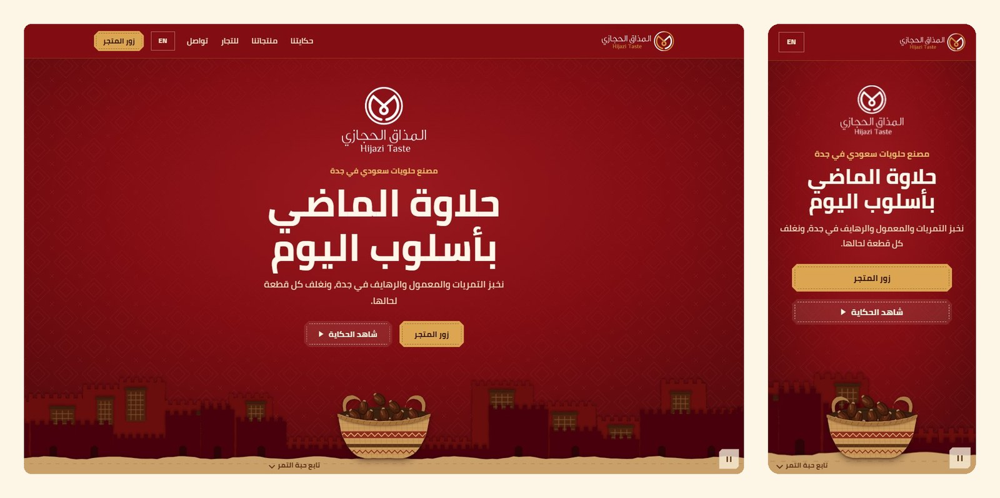
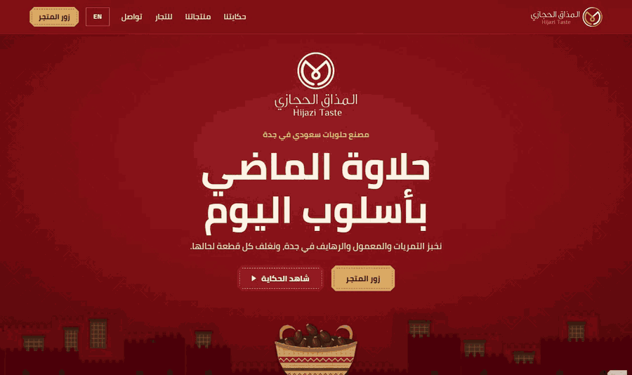
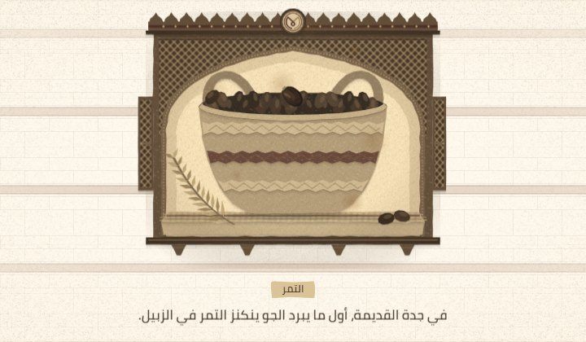
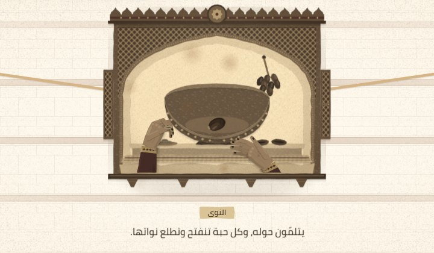
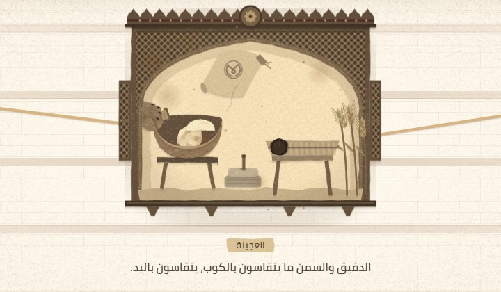
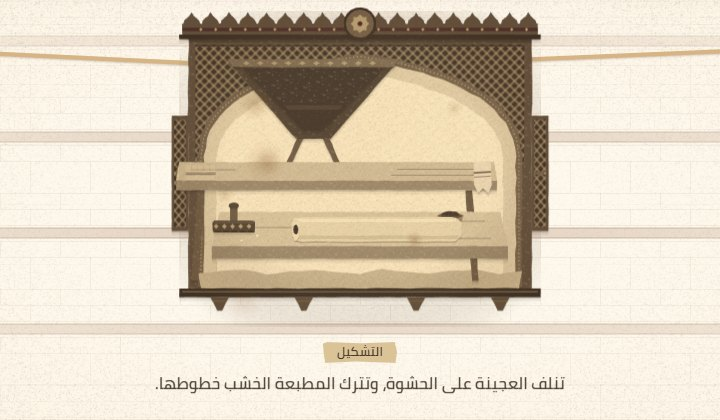
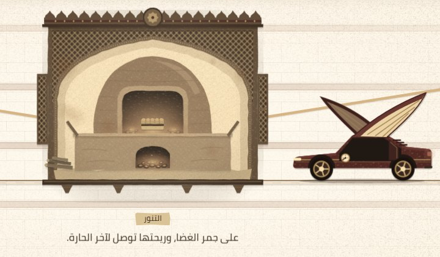
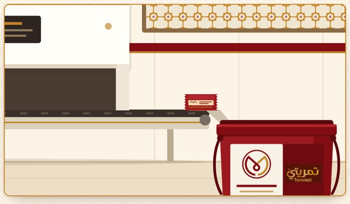

[English](README.md) · **العربية**

<h1 dir="rtl">موقع المذاق الحجازي</h1>

هذا موقع المذاق الحجازي، مصنع حلويات في جدة يصنع تمريات «تمريتي» والمعمول والرهايف وغيرها من الحلويات الحجازية. الموقع بالعربية، وفي القائمة زر `EN` يحوّله إلى الإنجليزية. يعرّف الموقع بالمصنع ومنتجاته للعملاء، وللمحلات والفنادق والشركات التي تريد بيعها أو تقديمها. لا تظهر في الموقع أي أسعار، وكل زر منتج يفتح متجر الشركة الإلكتروني.

مع النزول في الصفحة تسقط حبة تمر واحدة وتمرّ بمشاهد مرسومة بأسلوب قص الورق. تعرض المشاهد كيف كانت بيوت جدة القديمة تصنع هذه الحلويات، ثم المصنع الذي يغلّفها ويعبّئها اليوم.

تصميم وتطوير: **محمد الطنسي** · [لينكدإن](https://www.linkedin.com/in/mohammed-altounsi/)

تسجيل من النسخة التجريبية باستخدام زر «شاهد الحكاية»، بسرعة أعلى بخمس مرات تقريبًا.

## محتوى الصفحة

صفحة واحدة، من الأعلى إلى الأسفل:

- **الواجهة:** الشعار والعنوان، وزر للمتجر، وزر «شاهد الحكاية» الذي ينزل بالصفحة وحده ويتبع حبة التمر.
- **حكايتنا:** المصنع في جدة، وأول خطوة خارج المملكة في البحرين، والمشاركة في جلفود 2026 في دبي.
- **تمريتي:** خط المنتجات الأساسي، بخمسة أنواع (قمح أبيض، وقمح بر، ودخن، وشوكولاتة، وكليجا).
- **مغلف بالقطعة من الداخل:** لكل قطعة غلافها، فيمكن فتح العلبة مرات كثيرة، ووضع قطعة في شنطة المدرسة.
- **العائلة:** ست بطاقات منتجات (تمريتي سبيشل، ومعمولستا، ورهايف، وتمريتي كليجا، ومعمول البيت، والباكجات)، وكل بطاقة تفتح المتجر.
- **للتجار والشركات:** تتواصل المحلات والفنادق والمطاعم والشركات مع المصنع عبر واتساب أو البريد الإلكتروني.
- **كلمنا:** المتجر وواتساب والبريد الإلكتروني وإنستغرام وتيك توك.

## مشاهد قص الورق

فوق كل قسم مشهد، وعددها سبعة: الزبيل، والنوى، والحشوة، والعجينة، والتشكيل، والتنور، والمصنع. تهبط حبة التمر في كل مشهد، فينقلها المشهد خطوة إلى الأمام حتى تصير قطعة تمريتي مخبوزة. وتحت كل مشهد سطر قصير بالعربية. هنا ستة منها.

| | | |
|:-:|:-:|:-:|
|  |  |  |
| تمر في زبيل من الخوص | نزع النوى باليد | خلط العجينة في الوعاء |
|  |  |  |
| التشكيل على لوح بمطبعة خشب | الخَبز في التنور | التغليف في المصنع والنزول في العلبة |

في زاوية الشاشة زر يوقف كل الحركة. وإذا كان خيار تقليل الحركة مفعّلًا في إعدادات الجهاز، يظهر كل مشهد في حالته الأخيرة بلا حركة.

## طريقة البناء

- الموقع مكتوب بـ HTML وCSS وJavaScript فقط، بلا إطار عمل وبلا خطوة بناء.
- المشاهد رسومات SVG، وتحرّك JavaScript أجزاءها وحبة التمر مع النزول في الصفحة. وفي طريقها تهبط الحبة على حواف البطاقات والصور.
- كل نصوص الموقع في ملف واحد بالعربية والإنجليزية، وخط Cairo مستضاف مع الموقع نفسه.

---

> يعرض هذا المستودع تصميم الموقع وواجهته الأمامية، والكود المصدري خاص. لطلب موقع مشابه، راسلني على [لينكدإن](https://www.linkedin.com/in/mohammed-altounsi/).

